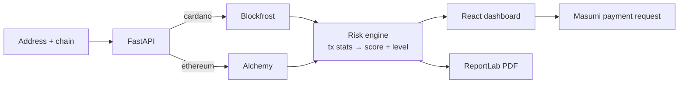

<div align="center">

# 👻 BlockPhantom

**Check whether a wallet is safe before you send it money. Paste a Cardano or Ethereum address and get a risk score, a transaction sample and a PDF report.**

*Built for the Cardano Hackathon Asia, where the team reached the finals.*

[](https://blockfrost.io/)
[](https://www.alchemy.com/)
[](https://www.masumi.network/)
[](https://fastapi.tiangolo.com/)
[](https://react.dev/)

</div>

---

## The idea

Scams on-chain are final: once ADA or ETH is sent, it is gone.
BlockPhantom gives anyone a quick **pre-send check**. It looks at a wallet's recent activity, scores how risky the wallet looks, and produces a report you can save or share.

It is also designed to run as a **paid AI agent on the Masumi network**. Another agent (or a person) can pay a small amount of ADA per check through Masumi's payment API.

## Features

| | |
|---|---|
| 🔎 **Multi-chain lookup** | Cardano addresses through **Blockfrost**, Ethereum addresses through **Alchemy** transfer history |
| 📊 **Risk score** | A 1–99 score, a probability and a low, medium or high level, with the transaction statistics behind it (count, average size, spread) |
| 🧾 **Transaction sample** | The latest transactions for the address |
| 📄 **PDF report** | One-click report generated with ReportLab |
| 💸 **Masumi payments** | Create a payment request in ADA and poll its status (`MasumiPay` component + `masumi_client.py`) |
| 🧪 **Demo mode** | Works without API keys, which is useful for a live pitch |

## How it works



## API

| Method | Endpoint | Returns |
|---|---|---|
| `GET` | `/wallet/{chain}/{address}/risk` | Score, probability, level and stats |
| `GET` | `/wallet/{chain}/{address}/history` | Recent transactions |
| `GET` | `/wallet/{chain}/{address}/pdf` | PDF risk report |

Add `?demo=true` to any endpoint to force demo data.

## Run locally

```bash
git clone https://github.com/kartikeyajay2006/Cardano-BlockPhantom.git
cd Cardano-BlockPhantom

# API: http://localhost:8000
pip install -r requirements.txt
export BLOCKFROST_API_KEY=...        # optional, for Cardano
export BLOCKFROST_NETWORK=mainnet    # or testnet
export ALCHEMY_API_KEY=...           # optional, for Ethereum
export MASUMI_API_KEY=...            # optional, for agent payments
uvicorn app:app --reload
```

The React files (`App.js`, `MasumiPay.jsx`, `index.js`) come from a Create React App project. Put them under `src/` (and `index.html`, `manifest.json` under `public/`), then run `npm install && npm start`.

## Status

This is a **hackathon prototype**. The Blockfrost, Alchemy and Masumi clients are implemented. The scoring currently runs in **demo mode with simulated scores**, which kept the pitch reliable. The next step is to replace it with a model trained on labelled scam and clean wallets.

## Author

Built by **[Kartikeya Yadav](https://github.com/kartikeyajay2006)**.
[LinkedIn](https://www.linkedin.com/in/kartikeya2006/) · [Portfolio](https://kartikeya-portfolio-rx7w.vercel.app/)
